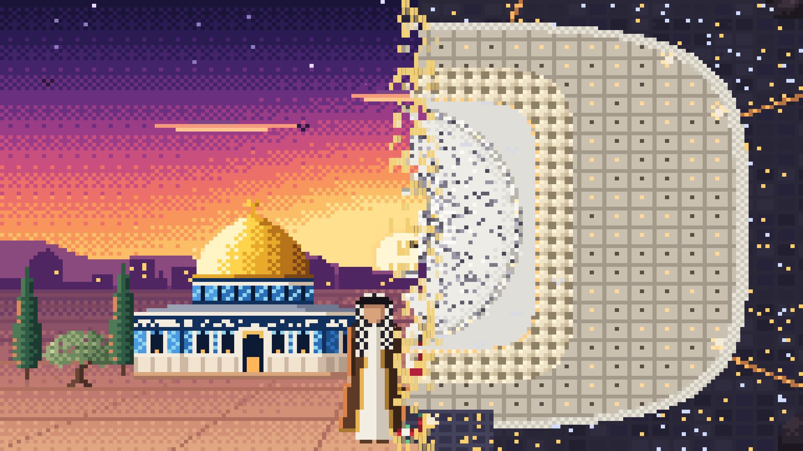
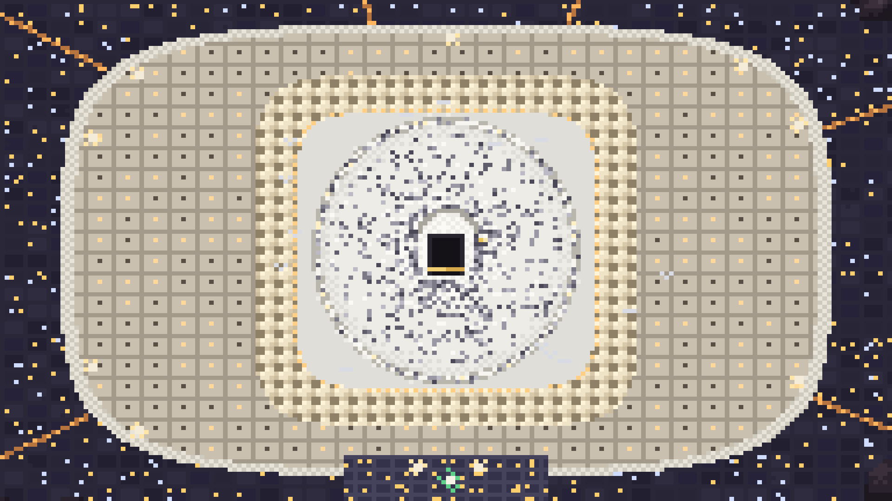
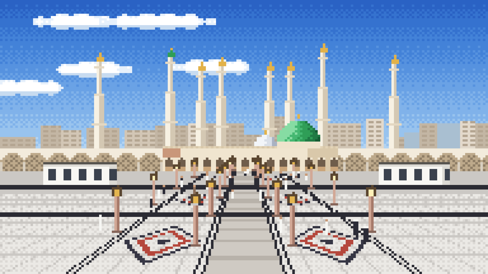
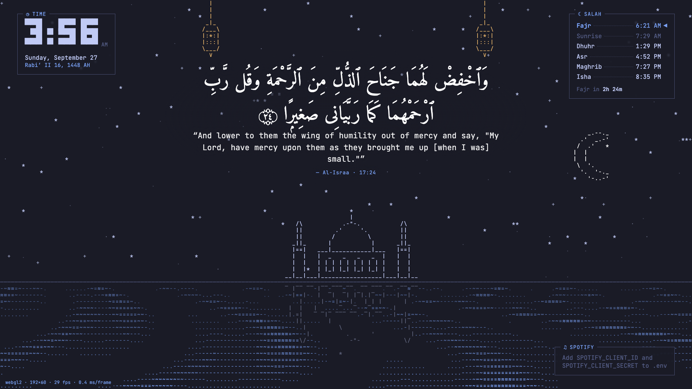

# RPi Dashboard

A full-screen home screen for the Raspberry Pi with an **Islamic ASCII pixel-art** look, inspired by the
terminal aesthetic of [Omarchy](https://omarchy.org).

The **home page follows the prayer times**. Each prayer brings its own place and light, with the two
of us standing in the center in local dress (faces left plain):

| Prayer | Scene |
|---|---|
| **Fajr** | Masjid Al-Aqsa. The sky follows the real clock from pre-dawn indigo to sunrise. |
| **Dhuhr** | The Kaaba at midday, with rows of pilgrims. We're in ihram and a black niqab. |
| **Asr** | Hagia Sophia through a dark gateway, in warm afternoon light |
| **Maghrib** | Madinah at sunset, the giant umbrellas open and the lamps lit |
| **Isha** | Masjid Al-Farooq, Atlanta, with a night market in the courtyard |

When the prayer changes, the scene switches with a pixel wipe.

**Tap any prayer in the Salah box** (Fajr, Dhuhr, Asr, Maghrib or Isha) to switch to that prayer's
scene:

- The live prayer stays highlighted in **yellow ◀**.
- The scene you picked shows in **light blue ◆**.
- To go back to live, tap it again or tap the yellow row. It also returns to live automatically when the
  next prayer time begins. For the first 12 minutes of a new
prayer, its Arabic name (e.g. العصر) assembles in the sky out of flying gold pixels, under the verse.

Widgets sit on top: a clock with the Hijri date and the Salah times. Between them, level with their
tops, a Quran verse from a curated list of uplifting verses changes every 30 minutes.

**Tap the right half of the screen** to sweep to the extra pages, and the left half to come back. Page 2
shows **Masjid al-Haram from the sky at night**, with no buttons or text:

- the Kaaba in the center, with pilgrims circling it in tawaf
- Hijr Ismail and Maqam Ibrahim
- the lit marble courtyard and the ring of Ottoman domes
- the expansion rooftops, glowing minarets and the clock tower
- the city lights and the mountains of Makkah

Page 3 is **Masjid an-Nabawi in Madinah** on a bright day, seen from the plaza:

- the Green Dome and the silver dome, with the minarets rising behind them
- rows of shade umbrellas and white kiosks
- a marble plaza in perspective with granite bands and red-and-black inlays
- lamp posts, and people walking across

Page 4 is a **wedding portrait at Masjid Al-Farooq, Atlanta**. The couple, drawn with plain faces,
stand in front of the pointed arch with its diamond mosaic. He wears a bisht with gold embroidery and a
checkered headband and holds a bouquet. She wears a green embroidered dupatta and a maang tikka. Petals
drift down in front of them.

The **Haram page** (page 2) has two cards on the rooftops, one on each side of the Kaaba:

- **Hijri:** today's Islamic date and the next important days (Ramadan, the Eids, Arafah, Ashura, the
  white days). Tap it for the whole year, with the date assembling itself in pixels.
- **Calendar:** your Google Calendar. Tap it for the month, with the Hijri date on every day. See
  [Calendar setup](#calendar-setup).

Pages 3 and 4 have no text.

Page 5 is a **System** screen for the Raspberry Pi, in the style of btop. It shows:
- CPU, temperature (with fan speed and any under-voltage or throttling since boot), memory, disk and
  network, with 30-minute charts.
- The top processes.
- How the dashboard itself is running: version, frame rate and when the calendar last synced.

A single word at the top right sums it up: **All good**, **Mostly fine**, **Working hard** or
**Needs attention**.

**Changing backgrounds:** for the home page, tap the clock and choose **Home background**. On every
other page, tap the small **▣ Background** box at the bottom middle. Tap a scene to preview it, then
**Save**, or **Cancel** to keep the old one. On the home page, **Follow prayer times** switches back to
the scene that changes with each prayer. Tap the right or left half of the screen, swipe, or press an arrow key
to move. The pages wrap around.

**Tap the clock** to open **Settings**:

- **Scenery mode:** only the pixel art, with no clock, Salah box or verse. Tap the right half for the
  next background and the left half for the previous one. It browses every scene you have, and there is
  one faint **✕** at the bottom middle to return home.
- **24-hour clock** on/off.
- **Quran verse** on/off.
- **Current prayer:** keeps the prayer's pixel-art name and start time (e.g. العصر, *ASR · 4:52 PM*)
  on the home screen all period. It sits under the verse, or takes the verse's place in its own box when
  the verse is off.

The toggles are saved to `config/dashboard.json`, and the screen reloads with them.





There is also an ASCII **night mosque** scene. Switch between them with one line in the config.



## Features

| Feature | Details |
|---|---|
| Kiosk mode | Opens full-screen on boot, with no mouse cursor and no browser chrome |
| Renderer | WebGL2 glyph-atlas renderer with a Canvas 2D fallback. Each cell has its own foreground and background color, which enables half-block pixel art. 30fps. |
| Prayer-time home | A scene per prayer, switched automatically, with a pixel-art "prayer started" animation. Preview with `?prayer=asr&banner`. |
| Pages | Pages, each with its own scene. Tapping the right or left half, a swipe, or the arrow keys play a pixel-wipe transition. |
| Settings & scenery mode | Tap the clock for settings. Scenery mode shows only the art, and you tap left or right to browse every scene. |
| Scenes | `config/scenes/*.json`. Each scene picks a background, characters and a theme. |
| Swappable art | Characters and backgrounds are JSON files, in ASCII or color pixel art. Upload any GIF or image to create your own. |
| Themes | Sunset, Tokyo Night, Catppuccin, Gruvbox. Add more as JSON. |
| Prayer times | Calculated offline with `adhan`. Countdown to the next prayer. |
| Quran verse | Full Uthmani text and Sahih International translation, bundled offline. Rotates through a curated list of uplifting verses. |
| Quran player | Tap the verse to pick any of the 114 surahs, recited by Shaykh Bandar Baleela. Loop one surah or continue to the next. The verse box shows the exact ayah being recited, and the recitation pauses for the first 20 minutes of each prayer. Needs `mpv`. |
| Spotify | Now playing, controls, and album art converted to ASCII (built in but hidden for now; add `spotify` to `widgets` to show it) |
| Live reload | Edit a config or asset file and the screen updates by itself |
| Any screen size | The composition is fixed at 60 rows, so a 7" panel shows the same picture as a TV |

## Quick start

### On the Raspberry Pi (first time)

Use Raspberry Pi OS Bookworm (64-bit) with the desktop. A Pi 4 or Pi 5 is recommended.

```bash
git clone https://github.com/VienJunaid/rpi-dashboard.git ~/rpi-dashboard
cd ~/rpi-dashboard
./scripts/setup-pi.sh          # installs Node, Chromium and mpv, builds, sets up autostart
nano .env                      # set LATITUDE / LONGITUDE (and Spotify keys, optional)
sudo reboot
```

After the reboot, the dashboard opens full-screen automatically. Make sure the Pi's timezone matches your
location, or the prayer times will be off:

```bash
sudo raspi-config nonint do_change_timezone America/New_York
```

### Updating the Pi

```bash
cd ~/rpi-dashboard && npm run update
```

This pulls the latest code, rebuilds, and restarts the server. The screen reloads by itself.

If an update changes `deploy/rpi-dashboard.service` or needs a new system package (the Quran player
needs `mpv`), run `./scripts/setup-pi.sh` again instead. It is safe to re-run.

### On your Mac (development)

```bash
nvm use                 # Node 22
npm install
cp .env.example .env
npm run dev             # → http://localhost:5173
```

UI changes hot-reload in the browser, and the server restarts on save. To preview full-screen, run
`npm run build && npm start`, then `npm run kiosk`.

## Commands

| Command | What it does |
|---|---|
| `npm run dev` | Server (:8080) and Vite (:5173) with hot reload |
| `npm run build` | Builds the UI and compiles the server |
| `npm start` | Runs the production server, which also serves the built UI |
| `npm run kiosk` | Opens the dashboard full-screen (Chromium on the Pi, Chrome on macOS) |
| `npm run update` | **On the Pi:** git pull, rebuild, restart |
| `npm run deploy` | **From the Mac:** rsync to the Pi, rebuild, restart (no git needed) |
| `npm run check` | Type-checks the UI and the server |
| `npm run fetch-quran` | Downloads the Quran text again. Pass a translation id, e.g. `-- en.yusufali`. |
| `npm run fetch-recitation` | Downloads the reciter's ayah timings again, e.g. `-- 217 "Shaykh Bandar Baleela"`. |
| `npm run art` | Regenerates the pixel-art figures and buildings from `scripts/art/*.mjs` |

On the Pi:

```bash
sudo systemctl status rpi-dashboard     # is the server running?
journalctl -u rpi-dashboard -f          # live server logs
sudo systemctl restart rpi-dashboard    # restart after editing .env
```

To exit kiosk mode, press `Alt+F4`, or run `pkill chromium` over SSH.

**Debugging:** open `http://127.0.0.1:8080/?debug` to see the renderer, grid size, and FPS. Add
`&renderer=canvas2d` to force the fallback renderer.

## Customizing

Every file below is watched. Save it and the dashboard reloads.

| To change… | Edit |
|---|---|
| **Pages and their scenes** | `config/dashboard.json` → `pages` (see below) |
| Characters in a scene and where they stand | `config/scenes/<scene>.json` → `characters` |
| A scene's background and theme | `config/scenes/<scene>.json` → `background`, `theme` |
| Sky colors, sun position, clouds, birds | `assets/backgrounds/aqsa-sunset.json` |
| Water speed, horizon height, stars | `assets/backgrounds/water.json` |
| Colors | `config/themes/<name>.json` |
| Widget placement, FPS, verse timing and list | `config/dashboard.json` |
| Location, API keys | `.env` (then restart the server) |

Pages are listed in order. Page 1 uses a scene per prayer:

```json
"pages": [
  { "sceneByPrayer": { "fajr": "aqsa-fajr", "dhuhr": "kaaba-dhuhr", "asr": "sophia-asr",
                       "maghrib": "madinah-maghrib", "isha": "farooq-isha" },
    "widgets": true, "verse": true },
  { "scene": "haram-aerial",   "widgets": false, "verse": false },
  { "scene": "madinah",        "widgets": false, "verse": false },
  { "scene": "farooq-wedding", "widgets": false, "verse": false }
]
```

- `widgets` shows the widgets from `widgets` on that page.
- `verse` shows the rotating Quran verse and the prayer-start animation on that page.
- Other scenes available: `aqsa-sunset`, `night-mosque` and `kazakh-meadow` (the two of us on horseback
  in a Kazakh mountain meadow). All of them appear in scenery mode.
- The optional `next-page` widget adds a visible **next ▸** button, if you ever want one back.

**Previewing any prayer's scene** without waiting for it:

| URL | Shows |
|---|---|
| `http://127.0.0.1:8080/?prayer=maghrib` | That prayer's scene |
| `?prayer=fajr&dawn=0.3` | The Fajr sky at a point in the sunrise (0 = dark, 1 = sun up) |
| `?prayer=asr&banner` | The prayer-start animation |
| `?scene=kazakh-meadow` | Opens scenery mode on any scene (names from `config/scenes/`) |

**Moving between pages:**
- Tap the **right half** of the screen to go right, and the **left half** to go left. Taps on the clock
  or the Salah box don't count.
- Swipe left or right.
- Press the arrow keys or Page Up / Page Down.
- Press Esc to leave scenery mode or close Settings.

A character entry in a scene looks like this:

```json
{ "asset": "keffiyeh-man", "x": 0.465, "y": 0.985, "anchor": "bottom-center" }
```

| Field | Meaning |
|---|---|
| `x`, `y` | Position as a fraction of the screen, from 0 to 1 |
| `anchor` | `top-left`, `top-center`, `center`, `bottom-center` or `bottom-left` |
| `flip` | Mirrors the character left to right |
| `color` | ASCII characters only. A theme token (`fg`, `accent`, `muted`, `verse`), a named color (`gold`, `teal`, `rose`), or a hex value. |
| `reflect` | ASCII characters only. Mirrors the character into the water. |

Characters are drawn in the order they're listed, so later entries appear in front.

Widget areas are `top-left`, `top-center`, `top-right`, `middle-left`, `middle-right`, `bottom-left`,
`bottom-center` and `bottom-right`. `verse.featured` is the list of verses to rotate through (for example
`"94:6"`). Empty it to show random short verses instead.

### Making your own characters and backgrounds

Open the uploader at **`http://127.0.0.1:8080/import.html`**, then:

1. Pick a GIF, PNG, JPG or WebP.
2. Choose **Pixel art (color)** or **ASCII**, and **Character** or **Background**.
3. Adjust the width and the number of colors while watching the live preview.
4. Click **Save & add to scene** or **Save & use as background**. The dashboard reloads with it.

For characters, use a PNG with a transparent background. The screen is 120 pixels tall, so figures
30–40 pixels tall fit the scene.

The built-in Al-Aqsa scene art is generated by code in `scripts/art/aqsa.mjs`, which builds each piece
from shapes, shading and patterns. Edit the script and run `npm run art` to regenerate. Asset formats are
in [ARCHITECTURE.md](ARCHITECTURE.md#asset-formats).

## Calendar setup

1. In Google Calendar on the web, go to **Settings → (your calendar) → Integrate calendar**, and copy the
   **Secret address in iCal format**. It isn't the public address, which only works for public
   calendars.
2. Put it in `.env` as `CALENDAR_ICS=…`. To add more calendars (for example your wife's), separate the
   links with commas. Each calendar gets its own color.
3. Restart the server: `sudo systemctl restart rpi-dashboard`, or restart `npm run dev`.

The secret address works like a password. Keep it in `.env`, which is never committed. If it ever
leaks, reset it in the same Google settings page. Changes show up within about 10 minutes.

If the Hijri dates are a day off from your masjid's announcements, tap the clock and change
**Hijri date** to −1 or +1.

## Spotify setup

1. Create an app at <https://developer.spotify.com/dashboard>.
2. In the app settings, add this redirect URI exactly: `http://127.0.0.1:8080/api/spotify/callback`
3. Put `SPOTIFY_CLIENT_ID` and `SPOTIFY_CLIENT_SECRET` in `.env`, then run
   `sudo systemctl restart rpi-dashboard`.
4. Log in once, using either of these:
   - **On the Pi:** press `Alt+F4` to leave kiosk mode, then open Chromium at
     `http://127.0.0.1:8080/api/spotify/login`.
   - **From your Mac:** run `ssh -L 8080:127.0.0.1:8080 pi@raspberrypi.local`, then open
     `http://127.0.0.1:8080/api/spotify/login` on the Mac.

Tokens are saved to `data/spotify.json` and refresh automatically. The playback controls need Spotify
Premium. The same SSH tunnel also lets you use the uploader from your Mac.

## Project layout

```
apps/web/        Svelte UI: renderer/, scene/, widgets/, importer/
apps/server/     Fastify API: prayer, quran, recitation, spotify, assets, config, live reload
assets/          characters/, backgrounds/, fonts/, quran/
config/          dashboard.json, scenes/, themes/
CLAUDE.md        project context for Claude Code sessions
deploy/          systemd unit
scripts/         setup-pi.sh, update.sh, kiosk.sh, deploy.sh, fetch-quran.mjs, fetch-recitation.mjs, art/
```

See [ARCHITECTURE.md](ARCHITECTURE.md) for how the pieces fit together.

## Credits

- Quran text: [Tanzil](https://tanzil.net) (Uthmani), used unmodified with attribution. Translation:
  Sahih International, via [alquran.cloud](https://alquran.cloud).
- Recitation: Shaykh Bandar Baleela. Audio and ayah timings from [mp3quran.net](https://mp3quran.net).
  The audio is not in this repository: each surah is downloaded the first time it plays.
- Fonts: [Amiri Quran](https://github.com/aliftype/amiri) and
  [JetBrains Mono](https://www.jetbrains.com/lp/mono/), both under the SIL Open Font License (see
  `assets/fonts/`).
